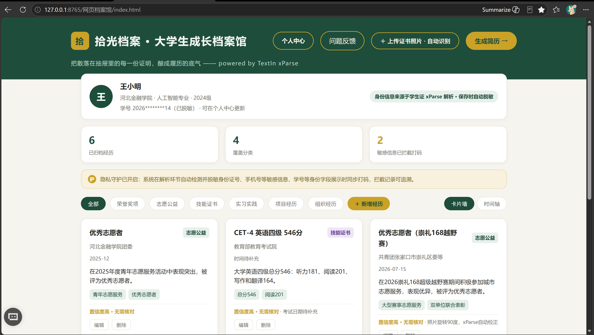
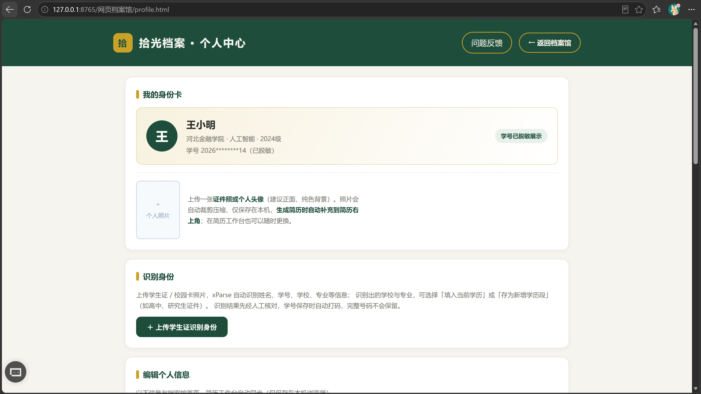
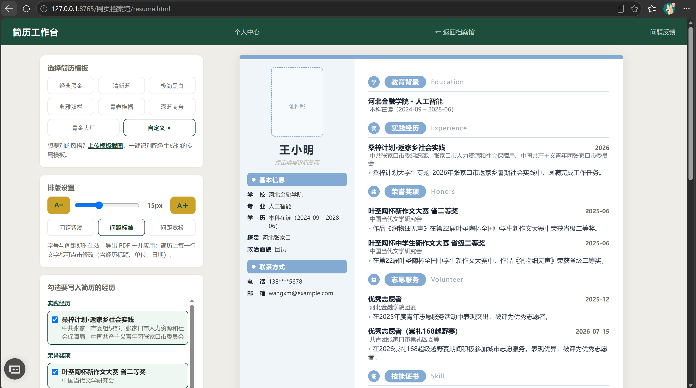
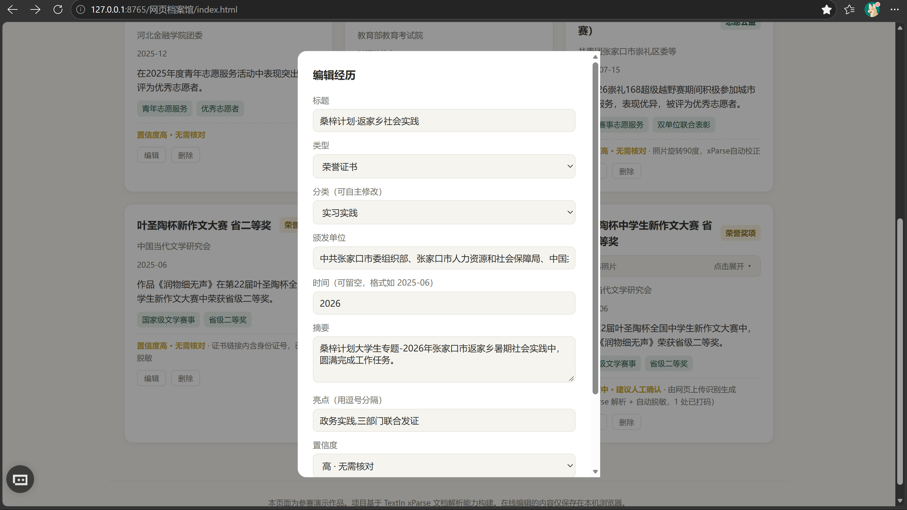

<div align="center">

# 拾光档案 · 大学生成长档案工作台

### 证书照片拖进来，AI 自动识别、脱敏、归档，毕业时一键生成简历

基于 [TextIn xParse](https://www.textin.com) 的本地网页应用 · 纯 Python 标准库 + 原生 HTML/JS · **数据全程只在你自己电脑上**

`Python` `xParse OCR` `零后端` `隐私脱敏` `简历生成` `CSDN × TextIn 文档觉醒大赛作品`

</div>

---

## 这是什么

大学四年攒下的奖学金证书、志愿者证明、四六级成绩单、学生证、学位证、实习证明……
真到填简历、参加面试时，却翻遍相册找不齐。

**拾光档案**把这些"纸"变成一个会成长的档案库——拍照上传即自动识别结构化，毕业时一键导出简历。

## 功能特性

### 三大 AI 识别
- **证书识别**：xParse 识别照片/PDF（拍歪 90° 自动转正），自动提取**标题、颁发单位、日期、摘要、亮点标签**并智能分类（荣誉奖项 / 志愿公益 / 实习实践 / 技能证书 / 组织经历）
- **学生证识别**：自动提取姓名、学校、专业、学号、入学/有效期，**去向可选**「填入当前学历」或「存为新增学历段」
- **简历模板识别**：上传任意简历截图，自动识别板块关键词并从图片提取主色/点缀色，生成你的专属模板

### 智能与可信
- **形近字纠错**：内置高置信度 OCR 错字修正表（如「接长奖学金」→「校长奖学金」、「交业单位」→「实习单位」、「二O二四」→「2024」）
- **自动脱敏**：身份证号、学号"保头保尾"打码（`2024****12`），完整号码永不入库
- **重复防重**：照片 SHA-256 指纹 + 标题相似度双重提醒，同一证书不重复建卡
- **文件安检**：魔数校验拦截改名文本等"假图片"
- **空值不瞎编**：识别不到的字段留空待补充，绝不杜撰

### 成长档案 → 一键简历
- 每张经历卡片带原件缩略图（默认折叠），时间线/卡片墙双视图，分类筛选
- 个人中心管理多段学历（高中/本科/研究生）与个人照片，三端自动同步
- **七套简历模板** + 截图自定义配色；AI 三档文案润色（极简概述 / 简历语言 / STAR 法则）
- 行级字号、板块开关、Word 式自由增删行；一键导出 PDF 打印

## 界面展示

> 建议录屏/使用时截取三张图放到 `screenshots/` 目录（文件名对应下面的引用即可自动显示）：
> `1-档案馆.png`（卡片墙）、`2-个人中心.png`（学生证识别）、`3-简历工作台.png`（模板+润色）

| 档案馆 · 经历卡片墙 | 个人中心 · 学生证识别 |
| :---: | :---: |
|  |  |
| **简历工作台 · 七模板 + AI 润色** | **识别结果 · 五字段结构化** |
|  |  |

演示视频：*发布后替换为视频号 / B站链接*

## 三步跑起来（Windows，全程不用写代码）

### 第 1 步：装 Python

到 https://www.python.org/downloads/ 下载 Python 3.10+，安装时**务必勾选 `Add python.exe to PATH`**。

### 第 2 步：装 xParse CLI 并登录（免费额度每天 1000 页）

先装 Node.js LTS：https://nodejs.org/ ，然后打开 cmd 执行：

```bash
npm install -g xparse-cli
xparse-cli auth
```

按提示用浏览器登录 TextIn 账号即可（没有账号到 https://www.textin.com 免费注册）。自查：

```bash
xparse-cli auth status     # 登录状态
xparse-cli quota           # 今日剩余额度
```

### 第 3 步：双击启动

双击 **`start.bat`**，浏览器自动打开 http://127.0.0.1:8765/ 。
`输入照片/` 附了 15 张虚构模拟证件（主角"王小明"），可直接体验全流程。

> 黑窗口是服务本身，最小化可以、别点 ×；双击两次也没事，会自动检测并直接打开浏览器。

## 目录结构

```
拾光档案/
├─ start.bat            双击启动（纯 ASCII，避免中文系统编码问题）
├─ server.py            本地服务：识别/字段提取/脱敏/文件安检（端口 8765）
├─ desensitize.py       敏感信息脱敏模块（也可命令行单独使用）
├─ auto_archive.py      可选：命令行批量归档
├─ 网页档案馆/
│  ├─ index.html        档案馆首页：上传证书、经历卡片墙/时间线
│  ├─ profile.html      个人中心：学生证识别、多段学历、个人照片
│  ├─ resume.html       简历工作台：模板/AI润色/导出 PDF
│  └─ feedback.js       三页共用的问题反馈弹窗
├─ tests/
│  └─ regress_ocr.py    识别规则离线回归（不耗 API 额度）
├─ 输入照片/             模拟证件素材（上传原件也归档到这里）
└─ screenshots/         （可选）放你的界面截图
```

首次运行自动生成 `解析结果/`、`脱敏结果/` 等运行目录。

## 识别质量如何保证

项目内置**离线回归机制**：每次 xParse 识别的原文自动留档，修改任何字段提取规则后，运行

```bash
python tests/regress_ocr.py
```

即可对全部历史真实 OCR 样本重新提取、逐字段核对，确保"修好一张、不改坏一批"。所有规则调整都基于真实 OCR 原文，不做脱离数据的猜测。

## 隐私说明

- 照片只存本机 `输入照片/`，卡片与个人信息只存**浏览器 localStorage**，零后端、零第三方数据库
- 唯一网络请求是把图片发送给 TextIn xParse 做 OCR
- 身份证号、学号在展示与保存时自动打码；彻底清理只需删除浏览器站点数据

## 常见问题

**Q：双击 start.bat 黑窗口一闪而过？**
失败时窗口会停住显示原因。提示 Python 找不到就重装并勾选 PATH。

**Q：提示 `xparse-cli 不是内部或外部命令`？**
Node.js 未安装或装完没重开 cmd，重装后重新执行 npm 命令。

**Q：识别失败 / 额度问题？**
先 `xparse-cli auth status` 看登录、`xparse-cli quota` 看额度；确认照片清晰、格式为 jpg/png/bmp/webp/tiff/pdf。

**Q：8765 端口被占用？**
关掉占用程序；若占用者正是本服务，直接访问 http://127.0.0.1:8765/ 即可。

**Q：换浏览器/清缓存后卡片没了？**
数据存浏览器本地，属设计如此（零后端、零隐私泄露）。

## 技术栈

Python 标准库（http.server / subprocess / hashlib / re）· 原生 HTML/CSS/JavaScript（零构建）· TextIn xParse CLI · Canvas 图片压缩 · localStorage

## 免责声明

本项目为编程学习与参赛作品，模拟证件均为虚构素材，仅供学习交流，请勿用于伪造证件等任何违法用途。

## License

[MIT](LICENSE)
